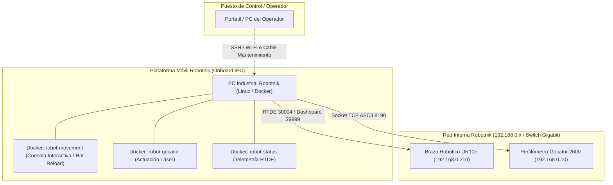

# Guía Técnica: Despliegue en el Computador Embarcado Robotnik y Operativa en Laboratorio
## Proyecto TFG: Perfilómetro Gocator 2600 y Robot UR10e sobre Plataforma Móvil Robotnik

---

## 1. Arquitectura del Sistema: El Robotnik como Nodo Enlace

En este proyecto, la plataforma móvil **Robotnik** actúa como el computador industrial embarcado (**Onboard IPC**) y centro neurálgico de comunicaciones. Es el único elemento físicamente conectado a la **red interna del robot** que puede interactuar de forma instantánea y simultánea con ambos dispositivos:



### Ventajas de Ejecutar los Contenedores sobre el Robotnik:
1. **Latencia Mínima (<1 ms):** Conexión por cable de red interna directa entre el Robotnik, el controlador del UR10e y el Gocator 2600.
2. **Independencia de la Red del Laboratorio:** Al ejecutarse localmente dentro del Robotnik, las caídas de Wi-Fi o saturación de la red externa no afectan a la trayectoria del brazo ni a la captura del perfilómetro.
3. **Imágenes Ultra Ligeras (216 MB / ~75 MB comprimido):** Diseñadas específicamente para no saturar el almacenamiento en disco de estado sólido del IPC industrial del Robotnik.

---

## 2. Empaquetado de las Imágenes Docker (En Casa / Entorno Actual)

Para trasladar **todas las imágenes y contenedores** al Robotnik sin depender de la conexión a Internet del laboratorio:

### 2.1. Guardar Todas las Imágenes en un Único Archivo
Como todas las imágenes comparten la misma capa base optimizada de 216 MB, Docker las empaqueta conjuntamente de forma ultra compacta:
```bash
docker save -o robotnik_tfg_images.tar robot-status:0.1 robot-movement:0.1 robot-gocator:0.1 robot-scan:0.1
```

### 2.2. Comprimir para Reducir el Tamaño de Traslado
```bash
# Comprime el archivo a ~75 MB
gzip -9 robotnik_tfg_images.tar
```
*Obtendrás `robotnik_tfg_images.tar.gz` (aproximadamente 75 MB).*

---

## 3. Transferencia de Software e Imágenes al Robotnik

### Opción A: Vía Pendrive USB (Física)
1. Copiar al pendrive:
   - `robotnik_tfg_images.tar.gz`
   - La carpeta del proyecto TFG actualizada (con `docker-compose.yml`, `src/`, `routes/`, etc.).
2. Conectar el pendrive al puerto USB del Robotnik.
3. Montar y copiar a la carpeta de trabajo del usuario (ej: `/home/robotnik/TFG`).

### Opción B: Vía SCP / Red (Wi-Fi o Cable de Mantenimiento)
Si te conectas a la red Wi-Fi del Robotnik o conectas tu portátil por cable a su puerto de mantenimiento:
```bash
# Copiar imágenes comprimidas al Robotnik
scp robotnik_tfg_images.tar.gz robotnik@<IP_ROBOTNIK>:~/

# Copiar el repositorio de código actualizado
scp -r c:/Users/Santi/Documents/GITHUB/TFG robotnik@<IP_ROBOTNIK>:~/
```

---

## 4. Puesta en Marcha en el Robotnik (En el Laboratorio)

### Paso 1: Conectar por SSH al Robotnik
Desde tu portátil:
```bash
ssh robotnik@<IP_ROBOTNIK>
cd ~/TFG
```

### Paso 2: Cargar las Imágenes Docker en el Daemon del Robotnik
```bash
# Carga las 4 imágenes en un solo comando
docker load -i ~/robotnik_tfg_images.tar.gz
```
Verificar que están presentes:
```bash
docker images
```
*Deberán aparecer listadas `robot-status:0.1`, `robot-movement:0.1`, `robot-gocator:0.1` y `robot-scan:0.1`.*

---

### Paso 3: Configurar el Archivo `.env` en el Robotnik
En la raíz de `~/TFG`, crear o verificar el archivo `.env`:
```env
ROBOT_IP=192.168.0.210
GOCATOR_IP=192.168.0.10
GOCATOR_PORT=8190
SWEEP_TIME=30
```

---

### Paso 4: Preparar el Teach Pendant del UR10e
1. Encender el robot y liberar los frenos en el Pendant.
2. En la esquina superior derecha de Polyscope, pulsar sobre el icono del mando y seleccionar **"Remote Control" (Control Remoto)**.

---

### Paso 5: Diagnóstico Rápido de Comunicación desde el Robotnik
Antes de mover el robot, verificar que el Robotnik tiene acceso instantáneo a ambos dispositivos por su red interna:
```bash
# 1. Comprobar robot UR10e (puertos 29999, 30003, 30004)
python3 src/robot_check_connection.py --ip 192.168.0.210

# 2. Comprobar perfilómetro Gocator (puerto 8190)
python3 src/gocator.py --status

# 3. Comprobar telemetría nativa RTDE desde el contenedor Docker
docker compose run --rm status
```
*Si los 3 comandos responden `OK / DISPONIBLE`, el enlace interno del Robotnik está 100% verificado.*

---

## 5. Operativa Desacoplada sobre el Robotnik (Dos Terminales)

Para operar de forma independiente el movimiento del brazo y la actuación del láser sobre el Robotnik, se recomienda abrir **dos sesiones SSH** (o usar `tmux` / `screen`):

### Terminal SSH 1 (Control del Brazo Robótico):
```bash
docker compose run --rm movement
```
*(O de forma nativa: `python3 src/robot_movement.py -i --json routes/default_tfg.json`)*.

**Acciones disponibles en la Consola Interactiva:**
* `[5]` : Consultar telemetría y pose actual del robot.
* `[2]` : Mover a posición de **ORIGEN / HOME** para comprobar y alinear la probeta.
* `[3]` : **Hot-Reload:** Si editas `routes/default_tfg.json` o cualquier archivo en `routes/`, pulsa `[3]` para recargar las coordenadas inmediatamente en memoria sin reiniciar la conexión RTDE.
* `[1]` : Ejecutar la trayectoria de barrido horizontal plana.

---

### Terminal SSH 2 (Actuación del Láser Gocator):
```bash
# Modo A: Disparo de barrido temporizado de 30 segundos
docker compose run --rm gocator python src/gocator.py --sweep 30

# Modo B: Consola interactiva del sensor (encender / apagar manualmente)
docker compose run --rm gocator python src/gocator.py -i

# Modo C: Encendido y apagado directo por comandos
docker compose run --rm gocator python src/gocator.py --cmd start
# ... observar emisión láser o ajustar exposición en GoPxL ...
docker compose run --rm gocator python src/gocator.py --cmd stop
```

---

## 6. Resolución de Problemas Frecuentes en el Robotnik

| Incidencia | Causa Probable | Solución |
| :--- | :--- | :--- |
| `El robot rechaza órdenes de movimiento` | Teach Pendant no está en modo remoto. | Activar "Remote Control" en el botón superior derecho de Polyscope. |
| `Protective Stop activo en UR10e` | Parada de protección por singularidad o toque. | Desbloquear desde la pantalla del Teach Pendant. |
| `Gocator Timeout en 192.168.0.10` | Cable de red interna desconectado del switch del Robotnik. | Comprobar cable Ethernet y ejecutar `ping 192.168.0.10` desde el Robotnik. |
| `Permiso denegado en Docker` | El usuario robotnik no está en el grupo `docker`. | Ejecutar con `sudo docker compose ...` o añadir usuario: `sudo usermod -aG docker $USER`. |
