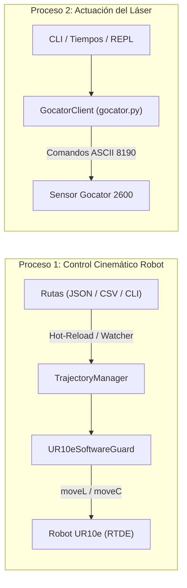

# Investigación Técnica: Desacoplamiento de Procesos y Carga en Caliente de Rutas
## Proyecto TFG: Perfilómetro Gocator 2600 y Robot Universal Robots UR10e

---

## 1. Resumen Ejecutivo y Diagnóstico

### 1.1. Contexto de la Decisión
Durante las fases recientes del desarrollo, se construyó un esquema de sincronización integrada en [`src/scan_sync.py`](file:///c:/Users/Santi/Documents/GITHUB/TFG/src/scan_sync.py), coordinando en un único hilo la activación del perfilómetro láser **Gocator 2600** mediante sockets TCP/IP ASCII y la ejecución cinemática del robot **UR10e** mediante el protocolo `ur_rtde`.

Si bien dicha sincronización representa un hito funcional avanzado, en la fase experimental y de laboratorio actual se detecta una necesidad operativa crítica:
> **Necesidad:** Volver temporalmente a una arquitectura simplificada y modular donde la ejecución cinemática del brazo y la actuación del láser operen de forma **100% independiente** (dos ejecutables separados), eliminando dependencias cruzadas en tiempo de ejecución, pero **preservando la capacidad de cargar trayectorias de forma flexible y en caliente (JSON / CSV / recarga dinámica)** sin alterar el código fuente.

### 1.2. Principales Inconvenientes del Enfoque Monolítico en Pruebas Físicas
1. **Acoplamiento de Fallos de Red / Hardware:**
   - Si el sensor Gocator sufre un retardo de red, timeout en el puerto 8190 o se encuentra apagado para calibración óptica, el script sincronizado bloquea o aborta el movimiento cinemático del UR10e.
   - De forma inversa, comprobar alcances espaciales o límites de juntas del robot obliga a lidiar con el estado del perfilómetro.
2. **Fricción en Calibración y Parametrización Óptica:**
   - Para ajustar el tiempo de exposición, rangos de medición o enfoque en el software GoPxL del Gocator, es habitual requerir que el láser permanezca encendido o realice disparos estáticos mientras el robot está inmóvil.
3. **Pérdida de Tiempo en Reconexiones RTDE:**
   - Cada vez que se modifica una coordenada y se relanza un script completo, `RTDEControlInterface` debe negociar sockets, cargar el script URScript en el controlador Polyscope y sincronizar telemetría (2 a 4 segundos por ejecución).

---

## 2. Nueva Arquitectura Propuesta: Desacoplamiento en Dos Procesos



### 2.1. Archivo 1: Control de Movimiento del Brazo (`src/robot_movement.py`)
* **Propósito:** Responsabilidad exclusiva sobre la cinemática, planificación articular/cartesiana y seguridad física del robot UR10e.
* **Características Clave:**
  - **Cero dependencias** del sensor Gocator (no importa `gocator.py` ni sockets de sensor).
  - Carga de rutas desde archivos externos (**JSON** y **CSV**).
  - Verificación estricta de la altura ($Z$ constante) para garantizar el plano de barrido requerido por el TFG.
  - Comprobación previa de seguridad espacial y articular mediante `UR10eSoftwareGuard`.
  - **Soporte de Carga en Caliente (*Hot-Reload*):** Permite mantener la conexión RTDE activa mientras monitoriza cambios en el archivo de ruta o recibe nuevas órdenes interactivas.

### 2.2. Archivo 2: Actuación del Perfilómetro Láser (`src/gocator.py`)
* **Propósito:** Responsabilidad exclusiva sobre el ciclo de vida de captura y emisión del sensor Gocator 2600 (GoPxL).
* **Características Clave:**
  - **Cero dependencias** del robot UR10e (sin `ur_rtde`).
  - Capacidad de actuar bajo demanda mediante comandos explícitos:
    - `start`: Enciende láser y comienza adquisición continua.
    - `stop`: Detiene adquisición y apaga emisión láser.
    - `trigger`: Envía pulso por software para registrar un perfil/volumen 3D.
    - `--tiempo <segundos>`: Ejecuta una ventana temporal de barrido (equivalente al script funcional original).
  - Modo interactivo tipo consola rápida (pulsar teclas para alternar estado).

---

## 3. Estrategia de Carga de Coordenadas "En Caliente"

Para cumplir con el requisito de cargar coordenadas dinámicamente y *en caliente* sin reiniciar la conexión con el robot, se plantean tres modalidades complementarias:

### 3.1. Modalidad A: File-Watcher con Conexión Persistente (`--watch`)
* **Mecanismo:** El script se conecta al robot mediante RTDE una única vez. A continuación, entra en un bucle de supervisión sobre el archivo seleccionado (`--json` o `--csv`), comprobando su fecha de última modificación (`os.path.getmtime`).
* **Flujo Operativo:**
  1. El operador arranca: `python src/robot_movement.py --json routes/mi_ruta.json --watch`.
  2. El robot conecta y queda en reposo o ejecuta la primera pasada.
  3. El operador edita `mi_ruta.json` en VS Code o modifica valores en `mi_ruta.csv` y guarda el archivo.
  4. El script detecta el cambio instantáneamente, recarga la ruta con `TrajectoryManager`, valida las cotas con `UR10eSoftwareGuard` y:
     - Solicita confirmación en consola: `[?] Nueva trayectoria detectada. ¿Ejecutar? (s/n/q): `
     - O la ejecuta automáticamente tras una cuenta atrás de seguridad (configurable).
* **Ventaja:** Elimina completamente el retardo de reconexión RTDE. Iteración rápida de ajustes milimétricos en el laboratorio.

### 3.2. Modalidad B: Carga Modular por Parámetros CLI sin Modificar Código
* **Mecanismo:** Ejecución *one-shot* especificando la fuente de datos:
  - `python src/robot_movement.py --json routes/default_tfg.json`
  - `python src/robot_movement.py --csv routes/ejemplo_ruta.csv`
  - `python src/robot_movement.py --modo cli --origen 60 -118 -75 -75 89 149 --destino 132 -108 -87 -72 90 220`
* **Ventaja:** Ideal para lanzadores automatizados o scripts bash sencillos.

### 3.3. Modalidad C: Consola Interactiva REPL en Vivo (`--interactivo`)
* **Mecanismo:** Menú en terminal que permite al usuario:
  - Opción 1: Recargar archivo actual.
  - Opción 2: Cambiar de archivo JSON/CSV.
  - Opción 3: Modificar velocidad/aceleración al vuelo.
  - Opción 4: Reposicionar al punto de origen antes de lanzar el escaneo.

---

## 4. Matriz Comparativa: Monolito vs. Enfoque Desacoplado

| Criterio | Enfoque Sincronizado (`scan_sync.py`) | Enfoque Desacoplado Propuesto |
| :--- | :--- | :--- |
| **Independencia Operativa** | Baja (ambos equipos deben responder simultáneamente). | **Total** (cada equipo opera de forma aislada). |
| **Tiempo de Prueba en Lab** | Alto (fallos en sensor obligan a abortar o esperar timeouts). | **Mínimo** (el operador lanza cada proceso según su necesidad). |
| **Ajuste de Trayectorias** | Requiere relanzar todo el proceso ante cambios. | **Carga en caliente** (se guarda el archivo y el robot ejecuta). |
| **Pruebas de Óptica / Gocator** | Requiere mover el robot o forzar modo dry-run cinemático. | **Inmediata** (`gocator.py --tiempo 15` o `gocator.py start`). |
| **Complejidad del Código** | Alta (gestión concurrente y excepciones anidadas). | **Baja y Limpia** (responsabilidad única por archivo). |
| **Uso de Docker** | Un contenedor único que orquesta todo. | Contenedores independientes en `docker-compose` (`movement` y `gocator`). |

---

## 5. Diseño Técnico de los Módulos

### 5.1. Refactorización de `src/robot_movement.py`
Se proyecta dotar al archivo de la capacidad de escuchar cambios en tiempo real mediante un bucle de vigilancia de archivos (*watcher*):

```python
def vigilar_y_ejecutar_en_caliente(ruta_archivo: str, tipo_archivo: str, robot_ip: str, dry_run: bool):
    """
    Mantiene la conexión RTDE activa con el robot y re-ejecuta la trayectoria
    cada vez que el archivo JSON o CSV se actualiza en disco.
    """
    print(f"[*] Modo 'Hot-Reload' activado para: {ruta_archivo}")
    ultimo_mtime = os.path.getmtime(ruta_archivo)

    # Conectar una sola vez al robot
    rtde_ctrl, rtde_rec = conectar_robot(robot_ip, dry_run)

    try:
        while True:
            time.sleep(0.5)
            nuevo_mtime = os.path.getmtime(ruta_archivo)
            if nuevo_mtime != ultimo_mtime:
                ultimo_mtime = nuevo_mtime
                print("\n[!] Se detectó modificación en el archivo de rutas.")
                
                # Cargar y validar
                if tipo_archivo == "json":
                    route = TrajectoryManager.from_json(ruta_archivo)
                else:
                    route = TrajectoryManager.from_csv(ruta_archivo)

                print(f"[*] Ruta recargada: '{route.name}' con {len(route.steps)} pasos.")
                confirmacion = input("[?] ¿Ejecutar en el robot? (s/n): ").strip().lower()
                if confirmacion == 's':
                    ejecutar_pasos(route, rtde_ctrl, rtde_rec, dry_run)
    finally:
        desconectar_robot(rtde_ctrl, rtde_rec)
```

### 5.2. Refactorización de `src/gocator.py`
Se dotará al cliente del Gocator de una interfaz CLI completa para actuación directa sin código adicional:

```bash
# Encendido manual
python src/gocator.py --cmd start

# Apagado manual
python src/gocator.py --cmd stop

# Disparo por software (trigger)
python src/gocator.py --cmd trigger

# Ventana de barrido temporizado (como en el script original de 30s)
python src/gocator.py --sweep 30

# Comprobación de estado de conexión
python src/gocator.py --status
```

---

## 6. Flujo de Trabajo en el Laboratorio

Con esta separación, el operador en el laboratorio dispondrá de máxima flexibilidad operativa:

### Escenario A: Calibración y Movimiento Secuencial Manual
1. **Terminal 1 (Láser):**
   ```bash
   python src/gocator.py --cmd start
   ```
   *(El láser permanece encendido proyectando la línea para alinear la pieza).*
2. **Terminal 2 (Robot):**
   ```bash
   python src/robot_movement.py --json routes/default_tfg.json
   ```
   *(El robot realiza el barrido mientras el operador visualiza el perfil en la interfaz web de GoPxL).*
3. **Terminal 1 (Láser):**
   ```bash
   python src/gocator.py --cmd stop
   ```

### Escenario B: Ajuste Rápido de Trayectoria en Caliente
1. **Terminal 1:**
   ```bash
   python src/robot_movement.py --json routes/default_tfg.json --watch
   ```
2. El estudiante ajusta las coordenadas del punto final en el archivo JSON para adaptarlo a la nueva probeta.
3. Al guardar el archivo en el editor, la terminal solicita confirmación inmediata y ejecuta el movimiento sin reiniciar conexiones.

---

## 7. Plan de Acción Recomendado

1. **Fase 1: Optimización de `src/robot_movement.py`:**
   - Asegurar el desacoplamiento total del perfilómetro.
   - Implementar el argumento `--watch` para recarga en caliente de archivos JSON y CSV.
2. **Fase 2: Optimización de `src/gocator.py`:**
   - Añadir argumentos de línea de comandos para control directo (`--cmd start|stop|trigger`, `--sweep <seg>`, `--status`).
3. **Fase 3: Actualización de `docker-compose.yml`:**
   - Configurar los servicios `movement` y `gocator` como servicios independientes preparados para ejecución interactiva (`stdin_open: true`, `tty: true`).
4. **Fase 4: Validación y Pruebas en Simulación (`--dry-run`):**
   - Verificar la recarga en caliente en entorno local sin hardware.
   - Validar suite de pruebas automáticas en `tests/`.
